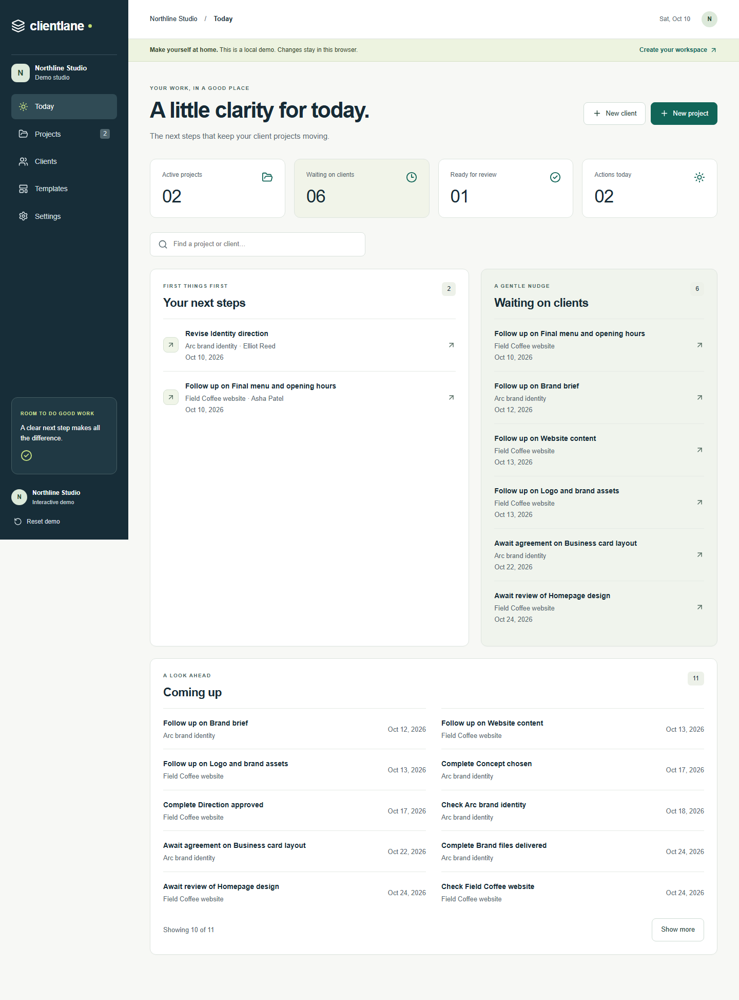
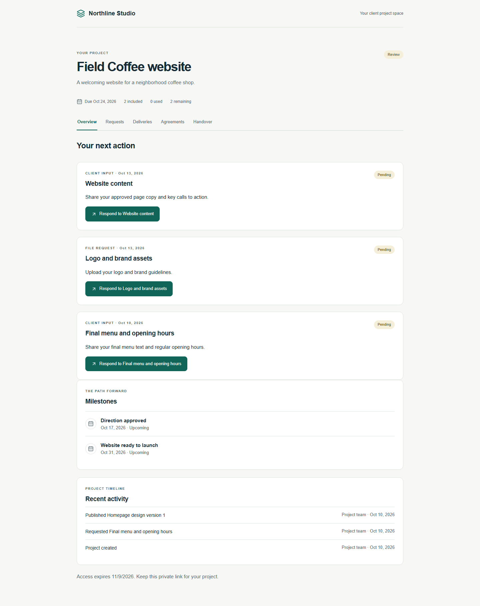
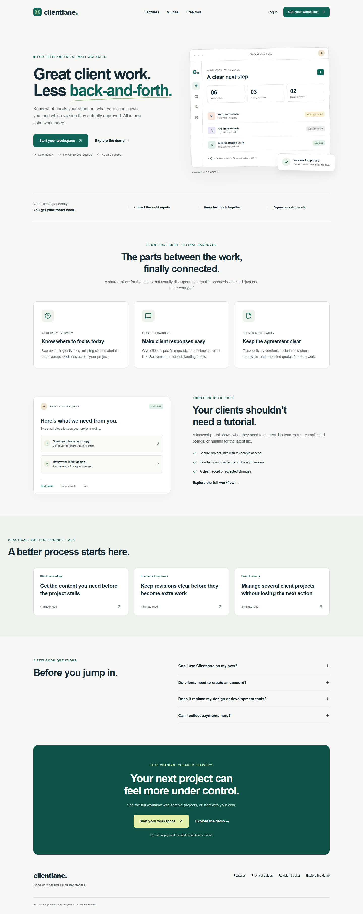
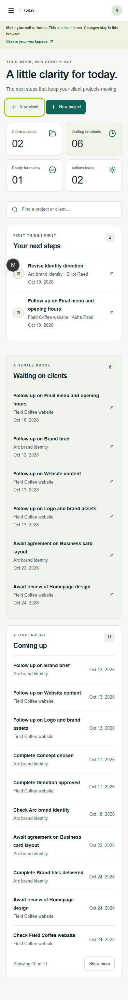
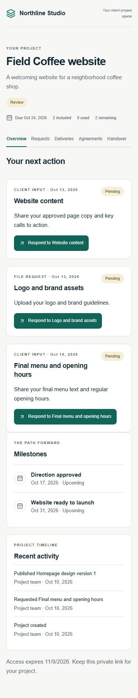
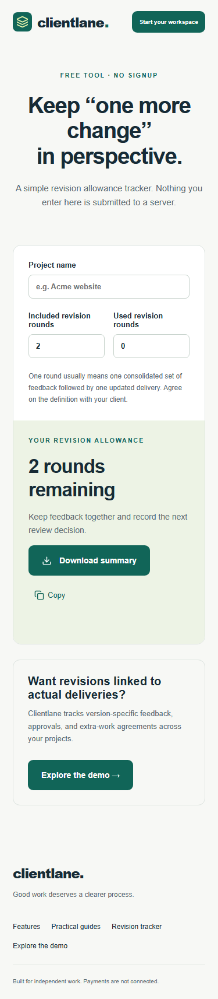

# Clientlane

**A client delivery workspace for freelancers and small studios.** Collect client inputs, deliver versioned work, track revision rounds, agree on extra scope and hand over approved results. Clients use a portal that needs no login.



> **Status:** feature-complete local build, verified end to end against a local Supabase stack (Auth, Postgres, Storage, SMTP). It is not deployed publicly and does not process payments. "Clientlane" is a working product name.

## Features

**For the studio**

- **Today / Waiting / Upcoming overview** with a concrete next action for every project.
- **Clients and projects** with milestones, due dates, assignees, archive/restore and explicit delete confirmation.
- **Templates** for web design, branding and retainer work, plus custom reusable templates.
- **CSV import with a validated preview** and full CSV/account data export.
- **Client requests** (text or file) with due dates and per-request reminder schedules. Reminders stop automatically once the input arrives, and each client gets one weekly digest email.
- **Versioned deliveries:** immutable versions per deliverable, feedback on each version, approve/request-changes decisions and a running revision allowance (included / used / remaining).
- **Agreements:** extra-work requests, owner quotes in exact cents and deadline changes the client must accept. The original deadline is never changed silently.
- **Team collaboration:** collaborators get project-scoped access, and internal notes never reach clients.
- **Handover:** a read-only package of approved latest versions, milestones and agreement history.

**For the client**

- **Private portal link** that expires and can be revoked. The token is hashed at rest, and the link grants access to one project only.
- One screen covering _your next action_, _work to review_ and _files_.
- **Optional free client accounts** that list projects across several providers. Invitations work both ways: a studio can invite its client, and a client can invite their existing provider with a project brief.

**Public site**

- Marketing pages with metadata, an OpenGraph image, a sitemap, robots rules and structured data, plus three practical guides.
- A free **revision-allowance tracker** tool.
- An **interactive demo** at `/demo` with no signup. Its state stays in the browser.

## Screenshots

| Client portal                                        | Marketing site                                    |
| ---------------------------------------------------- | ------------------------------------------------- |
|  |  |

| Workspace (mobile)                                         | Client portal (mobile)                                             | Revision tracker (mobile)                                             |
| ---------------------------------------------------------- | ------------------------------------------------------------------ | --------------------------------------------------------------------- |
|  |  |  |

A captioned **product tour video** recorded from the real application is in [`docs/product-tour/`](docs/product-tour/). To watch it in the bundled player, run `node scripts/serve-product-tour.mjs` and open http://127.0.0.1:3012.

## Tech stack

| Layer      | Tools                                                                 |
| ---------- | --------------------------------------------------------------------- |
| App        | Next.js 16 (App Router, server actions), React, TypeScript            |
| Backend    | Supabase: Postgres with row-level security, Auth, private Storage     |
| Validation | Zod                                                                   |
| Email      | Nodemailer over SMTP; Mailpit for local testing                       |
| Testing    | Vitest (unit + integration), Playwright, axe-core accessibility scans |
| Tooling    | ESLint, Prettier, GitHub Actions CI                                   |

## Architecture highlights

- **Pure domain layer** (`src/lib/domain`): validated commands, Zod schemas and selectors. The domain has no UI or database dependencies and is unit-tested on its own.
- **Optimistic concurrency:** each workspace aggregate is saved through an atomic compare-and-save database function. Direct table writes are revoked, and a stale save loses cleanly instead of overwriting newer data.
- **Layered access control:** memberships, project access, portal grants, client accounts and the notification outbox each have dedicated tables, protected by RLS _and_ server-side checks. The service-role key is server-only and is used only after explicit authorization.
- **Private files through an authenticated proxy.** Access and revocation are checked again on every upload and download. Type and size are validated, and executable HTML/SVG is rejected.
- **Reliable notifications:** the queue uses leased, deduplicated, retryable jobs, and eligibility is checked again just before each SMTP send. Locally a worker process drives it. A hosted scheduler would call the authenticated `/api/jobs` endpoint.
- **Explicit limits:** inputs that exceed a limit are rejected, never silently truncated.

Trade-offs are documented in [`docs/DECISIONS.md`](docs/DECISIONS.md).

## Getting started

Requirements: Node.js 22+ and Docker Desktop (Linux containers).

```sh
npm ci
npm run setup:local   # starts an isolated local Supabase project and writes .env.local
npm run dev           # http://127.0.0.1:3001
npm run worker        # optional, second terminal: reminders and weekly digests
```

- Demo without an account: http://127.0.0.1:3001/demo
- Local email inbox (Mailpit): http://127.0.0.1:55324

`.env.local` is generated locally and git-ignored. See [`.env.example`](.env.example) for the variables.

## Testing

| Suite                                    | Command                                         | Result at last verification |
| ---------------------------------------- | ----------------------------------------------- | --------------------------- |
| Unit                                     | `npm test`                                      | 108 passed                  |
| Integration (real local Supabase + SMTP) | `npm run test:integration`                      | 47 passed                   |
| Browser (production build, Chromium)     | `PLAYWRIGHT_SERVER=production npm run test:e2e` | 35 passed                   |
| Lint, types, unit tests, build           | `npm run verify`                                | passed                      |

CI (`.github/workflows/ci.yml`) runs formatting, lint, type checks, all three test suites and `npm audit` on every push. Full evidence is in [`docs/VALIDATION.md`](docs/VALIDATION.md).

## Project structure

```
src/
  app/            routes: marketing, guides, tools, auth, /app (studio), /client,
                  /portal/[token], /demo, /api/files, /api/jobs
  components/     workspace, client-account and marketing UI
  lib/domain/     commands, schemas, selectors, CSV import, sample data
  lib/backend/    server actions, authorization, crypto, files, mail
  lib/supabase/   browser and server clients
supabase/
  migrations/     schema, RLS policies and atomic RPCs
scripts/          local setup, notification worker, product-tour recording
tests/            unit, integration and e2e suites
docs/             operations guide, decisions, validation, screenshots, product tour
```

## Documentation

- [`docs/OPERATIONS.md`](docs/OPERATIONS.md): local setup details, hosted launch prerequisites, client-account behaviour and security notes
- [`docs/DECISIONS.md`](docs/DECISIONS.md): implementation decisions and their costs
- [`docs/VALIDATION.md`](docs/VALIDATION.md) and [`docs/verification/`](docs/verification/): test evidence and review reports
- [`docs/superpowers/`](docs/superpowers/): design spec and implementation plans
